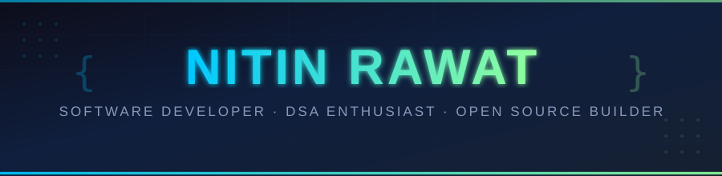

<div align="center">



</div>

<br/>

<div align="center">

[](https://leetcode.com/u/Nitin_Rwt2326/)
[](https://github.com/nitinrwt22)
[](https://www.linkedin.com/in/nitin-rawat-477382312/)
[](mailto:nitin.rawat2326@gmail.com)

</div>

<br/>

---

## `> whoami`

```
B.Tech CSE @ Graphic Era Hill University, Dehradun  ·  2024 – 2028  ·  CGPA: 8.78
Top 12 @ HACK4DELHI (NSUT, Delhi)  ·  5+ Hackathons  ·  150+ GitHub Contributions this year
```

I'm a sophomore CS student who builds things that **actually work**. I like systems that are fast, codebases that are clean, and problems that make me think. Currently obsessed with **DSA, full-stack development**, and building tools that scratch my own itch.

> *"I don't just learn technologies — I build with them."*

<br/>

---

## `> ls -la projects/`

<br/>

### 🧠 CodeMaster — C Code Analyzer & Symbol Browser
> `C` · `Data Structures` · `React` · `Vite` · `JSON`

A **full-stack static analysis platform** that audits C programs and visualizes architectural dependencies — no external tools, no shortcuts. Built from scratch.

| What it does | How it does it |
|---|---|
| Symbol lookup in **O(log N)** | AVL Tree–backed symbol table |
| Autocomplete in **O(L)** | Trie over all identifiers |
| Function call graph | Directed graph with DFS traversal |
| AST construction & traversal | Custom recursive descent parser |
| Live dashboard | React + Vite with real-time JSON rendering |

**Pipeline:** `Source Code → Lexer → Parser → AST → Graph + HashTable → CFG → Quality PQ → JSON → React`

[](https://github.com/nitinrwt22)

<br/>

---

### 🚚 ATM Route Optimizer — Cash Replenishment Platform
> `C++` · `HTML` · `CSS` · `Tailwind CSS` · `JavaScript` · `Canvas`

An **end-to-end logistics optimizer** for ATM fleet management. Monitors real-time cash levels, identifies critical machines, and dispatches optimally loaded trucks.

| Feature | Algorithm |
|---|---|
| ATM urgency ranking | Priority Queue (Min-Heap) |
| Truck loading under ₹50L constraint | 0/1 Knapsack DP |
| Route clustering | K-Means Clustering |
| Route ordering | TSP approximation |
| Real-time visualization | HTML5 Canvas dashboard (glassmorphic) |

**Scale:** Optimized servicing for **100+ ATMs** while maximizing cash availability and minimizing downtime.

[](https://github.com/nitinrwt22)

<br/>

---

### 📚 CramRoom — Collaborative Exam Prep Platform
> `Next.js` · `Node.js` · `Express` · `PostgreSQL` · `JWT`

A **backend-driven study platform** that structures exam prep into time-bound, collaborative environments. Think less chaos, more discipline.

| Feature | Implementation |
|---|---|
| Real-time chat (pin/react) | Express + WebSockets |
| Collaborative sessions | PostgreSQL state machines |
| Auth & access control | JWT with role-based gates |
| Performance | 60% fewer DB round-trips via batched queries |

[](https://github.com/nitinrwt22)

<br/>

---

## `> cat skills.json`

```json
{
  "languages":  ["C", "C++", "Python", "JavaScript"],
  "frontend":   ["HTML", "CSS", "React.js", "Next.js", "Tailwind CSS"],
  "backend":    ["Node.js", "Express.js"],
  "databases":  ["MySQL", "PostgreSQL", "Firebase"],
  "tools":      ["Git", "GitHub", "VS Code", "Postman", "Figma", "Vercel"],
  "core_cs":    ["DSA", "OOP", "DBMS", "System Design", "Graph Theory"],
  "currently":  ["Learning full-stack patterns", "Deepening DSA", "Building in public"]
}
```

<br/>

---

## `> cat achievements.log`

```
[2024] Top 12 — HACK4DELHI Hackathon, organized by NSUT Delhi
[2024] Participated in 5+ hackathons, actively competing
[2024] 450+ LeetCode problems solved
[2024] 150+ GitHub contributions in the past year
[2023] 88.6% — CBSE Class XII, Army Public School, Dehradun
```

<br/>

---

## `> stat github_activity`

<div align="center">


</div>

<br/>

---

## `> ping me`

I'm always open to interesting conversations, collaborations, or opportunities.

<div align="center">

| Platform | Link |
|---|---|
| 💼 LinkedIn | [nitin-rawat-477382312](https://www.linkedin.com/in/nitin-rawat-477382312/) |
| 💻 GitHub | [nitinrwt22](https://github.com/nitinrwt22) |
| 🧩 LeetCode | [Nitin_Rwt2326](https://leetcode.com/u/Nitin_Rwt2326/) |
| 📧 Email | [nitin.rawat2326@gmail.com](mailto:nitin.rawat2326@gmail.com) |

</div>

<br/>

---

<div align="center">

<sub>Maintained by <strong>Nitin Rawat</strong> · Last updated May 2026 · Built with ☕ and late nights</sub>

</div>
